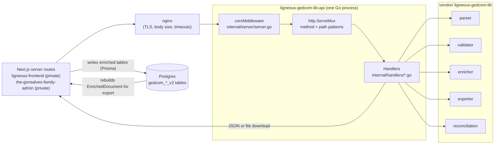

# Architecture: ligneous-gedcom-lib-api

## Summary

`ligneous-gedcom-lib-api` is a stateless Go HTTP service of about 500 lines. It puts [ligneous-gedcom-lib](https://github.com/lesfleursdelanuitdev/ligneous-gedcom-lib) behind nine routes. A front end uploads a `.ged` file and gets back the parsed tree, validation findings and the flat `EnrichedDocument` tables as one JSON object. It can also send tables back to get a GEDCOM, JSON or CSV download, or send two versions of a tree to get a merge plan. All GEDCOM logic lives in the library, which is vendored into `vendor/`. This repo adds routing, upload handling, JSON encoding, CORS and deployment files. It has no database, no auth and no state between requests. The project map is in [Ligneous](https://github.com/lesfleursdelanuitdev/Ligneous).

## Components and data flow

The service never touches Postgres. The front ends read and write the database and use this service as a pure function from input to JSON.

## Components

| Path | Responsibility |
|---|---|
| `main.go` | Reads `-port` (default 8091), `PORT` and `LISTEN_ADDR`, builds the server, calls `ListenAndServe` |
| `internal/server/server.go` | Registers routes with Go 1.22 method patterns (`"POST /api/v1/parse"`) and wraps the mux in `corsMiddleware` |
| `internal/handlers/handlers.go` | `type Handlers struct{}`: an empty receiver, so handlers share no state |
| `internal/handlers/helpers.go` | `extractGedcomFile` (multipart field `file`), `writeJSON`, `writeError` |
| `internal/handlers/parse.go`, `validate.go`, `enrich.go`, `parse_validate.go`, `pipeline.go` | Upload endpoints: different slices of parse -> validate -> enrich |
| `internal/handlers/export.go` | `POST /api/v1/export`: `EnrichedDocument` JSON to a `.ged`, `.json` or `.csv` download |
| `internal/handlers/reconcile.go` | `POST /api/v1/reconcile/merge-plan` and `/session`: two `EnrichedDocument`s to a `MergePlan` |
| `internal/handlers/health.go` | `GET /health` returns `{"status":"ok"}` |
| `vendor/` | Vendored library and `google/uuid`. The library's non-test files match `ligneous-gedcom-lib` master. |
| `Dockerfile`, `docker-compose.yml`, `deploy/` | Container build, systemd unit, nginx example |

The full endpoint table, with inputs and outputs, is in the [README](../README.md#endpoints). Associate (`ASSO`/`RELA`) payloads are in [API_REFERENCE.md](../API_REFERENCE.md).

## Key data structures

The service passes the library's types straight through `encoding/json`. It defines no domain types of its own.

- **`document`**: a `gedcom.GedcomDocument`, the lossless tree.
- **`enriched`**: an `enricher.EnrichedDocument`, the flat tables. The handlers set `ed.Document = nil` before encoding, so the tree is not sent twice.
- **`validation`**: `{ valid, errors }`, where `errors` is the list of `validator.ValidationError`. `valid` is false only when a finding has error severity.
- **`stats`**: `enricher.Stats`, the row counts.

The README of the library explains both IRs with examples: [The intermediate representation](https://github.com/lesfleursdelanuitdev/ligneous-gedcom-lib#the-intermediate-representation-ir).

## Request lifecycle

The main import call is `POST /api/v1/parse-validate-enrich?generateIds=true` (`internal/handlers/pipeline.go`):

1. **Accept.** `net/http` accepts the connection and runs the request on its own goroutine.
2. **CORS.** `corsMiddleware` sets `Access-Control-Allow-Origin: *` and the allowed methods and headers. An `OPTIONS` request ends here with 204.
3. **Route.** `ServeMux` matches method and path. A wrong method gets 405 from the mux.
4. **Read upload.** `extractGedcomFile` calls `ParseMultipartForm(10 MB)`, opens the `file` field and reads it fully into a byte slice. Failure returns 400.
5. **Parse.** `parser.Parse(bytes.NewReader(data))` with default options. A fatal parse error returns 422 with the error text, which includes the line number.
6. **Validate.** `validator.Validate(doc)`. The handler counts error-severity findings to set `valid`. Findings never stop the pipeline.
7. **Enrich.** `enricher.Enrich(doc)`. With `generateIds=true`, `enricher.GenerateIDs(ed)` puts a UUID on every row.
8. **Respond.** `writeJSON` sends `document`, `warnings`, `validation`, `enriched` and `stats` with status 200.

The other routes are shorter:

- **Export** decodes `{ format, filename, enriched }`. For `gedcom` it always calls `exporter.EnrichedToGEDCOM`, which rebuilds the file from the tables rather than from any tree in the payload. `json` and `csv` use `FromEnrichedToJSON` and `FromEnrichedToCSV`. The handler sets `Content-Disposition` for a download.
- **Reconcile** reads at most 25 MB, decodes `left`, `right` and optional `options` (merged onto library defaults), then calls `reconciliation.BuildMergePlan`. `/session` also wraps the plan in a draft `ReconciliationSession`.

## Design decisions and tradeoffs

| Choice | Cost | Why |
|---|---|---|
| Thin shell over a separate library | Two repos to version. The vendored copy must be refreshed with `go mod vendor`. | The library stays free of HTTP and can be tested and reused alone. |
| Vendor the library, keep `replace => ../ligneous-gedcom-lib` | A local build against the sibling checkout and the vendored copy can drift | `go build -mod=vendor` and the Docker build need only this repo |
| Stateless, no database | Front ends must send whole `EnrichedDocument`s for export and reconcile, which can be large | Any instance can serve any request. Nothing to migrate or back up. |
| One combined `parse-validate-enrich` endpoint | Large responses, since the tree and the tables both go back | One upload and one parse per import. The front end gets everything it needs to show findings and insert rows. |
| GEDCOM export always from tables | Anything that exists only in the original tree is not exported | Export matches what is in the database, the same source the JSON and CSV exports use (comment in `export.go`) |
| `CORS *`, no auth | Anyone who can reach the port can use it | The callers are Next.js server routes, not browsers. The deploy files bind to `127.0.0.1` behind nginx. |
| Standard library only (`net/http`, `ServeMux` patterns) | No middleware ecosystem, no request logging | Fewer dependencies. Go 1.22 patterns cover method routing. |
| Two-stage Docker build: `CGO_ENABLED=0` binary copied into `alpine:3.19` | No cgo-based packages can be used | Small runtime image without a Go toolchain. The same static binary also runs directly under systemd. |

## Concurrency model

- The service starts no goroutines of its own. There is no `go` statement, `sync` use or channel in non-vendored code.
- `net/http` serves each request on its own goroutine, so several uploads are parsed at the same time on different cores.
- Handlers share only the empty `Handlers` struct. Each request owns its byte slice, tree and tables.
- The library is safe to call this way. It keeps per-call state in locals, and its package-level maps and compiled regexps are only read after init. The library's [ARCHITECTURE.md](https://github.com/lesfleursdelanuitdev/ligneous-gedcom-lib/blob/master/docs/ARCHITECTURE.md#concurrency-model) has the details.
- There is no limit on concurrent requests. Memory use is roughly the sum of all in-flight files, trees and tables.

## Error handling

- Errors are JSON `{"error": "..."}` written by `writeError`.
- 400: bad multipart, missing `file` field, invalid JSON, missing `enriched`, missing `left` or `right`, bad reconcile `options`, unknown export format.
- 422: the GEDCOM parser failed, or `left`/`right` could not be decoded as an `EnrichedDocument`.
- 413: reconcile body over 25 MB.
- 500: CSV export failed.
- Validation findings are data, not errors. They come back with status 200.
- `writeJSON` ignores the encoder's error. Headers are already sent at that point, so a failed write shows up only as a cut-off body.

## Testing

- `go test -mod=vendor ./...` runs 3 tests in `internal/handlers/associates_test.go`. All pass (checked 2026-10-09, Go 1.24.4).
- The tests build multipart requests, call handlers directly with `httptest.NewRecorder`, and check that `ASSO`/`RELA` data appears in `/enrich` and `/parse-validate-enrich` and comes back out of GEDCOM export.
- The router, CORS middleware, reconcile handlers and error paths have no tests here. The parsing, validation, enrichment and export logic is tested in the library (102 tests).

## Known limitations

- **No auth, `Access-Control-Allow-Origin: *`.** Run it on loopback behind nginx. The systemd unit sets `LISTEN_ADDR=127.0.0.1:8091`. `docker-compose.yml` publishes `8091:8091` on all interfaces unless you uncomment `LISTEN_ADDR`.
- **No hard upload cap in Go.** `ParseMultipartForm(10 MB)` limits memory, not size: larger parts spill to temp files. There is no `http.MaxBytesReader`. The nginx example sets `client_max_body_size 128m`. `/export` has no body limit at all.
- **Whole file in memory.** The handler reads the upload into a byte slice, and the library then holds the lines, the tree and the tables.
- **No server timeouts.** `http.Server` sets only `Addr` and `Handler`, so read, write and idle timeouts are unset. The nginx example uses 600-second proxy timeouts.
- **No cancellation.** Handlers call `parser.Parse` with default options, so a client that disconnects does not stop the parse.
- **No graceful shutdown.** `main` calls `log.Fatal(srv.ListenAndServe())`.
- **No request logging or metrics.**
- **`filename` is not sanitized** before it goes into `Content-Disposition`.
- **No license file.** All rights reserved.

## How it connects to the other repos

- [ligneous-gedcom-lib](https://github.com/lesfleursdelanuitdev/ligneous-gedcom-lib) provides all GEDCOM logic. This repo vendors it.
- `ligneous-frontend` (private) calls `parse-validate-enrich` on upload and writes `enriched` to Postgres in one Prisma transaction, using the shared `ligneous-prisma` (private) schema. It calls `export` for downloads.
- `the-gonsalves-family-admin` (private) calls `parse-validate-enrich`, `export` and `reconcile/merge-plan`. It stores the upload JSON as a pending import for review.
- `the-gonsalves-family` (private) is the public family site that admin manages.
- [ligneous-gedcom-flask-api](https://github.com/lesfleursdelanuitdev/ligneous-gedcom-flask-api) reads the Postgres tables the importers fill. It does not call this service.
